<h1 align="center">Mu The Matrix for Mac</h1>

<p align="center">
  <b>Play Mu The Matrix on an Apple-silicon Mac.</b><br>
  One download. No CrossOver. The original launcher and game, at the game's full 25 frames per second.
</p>

<p align="center">
  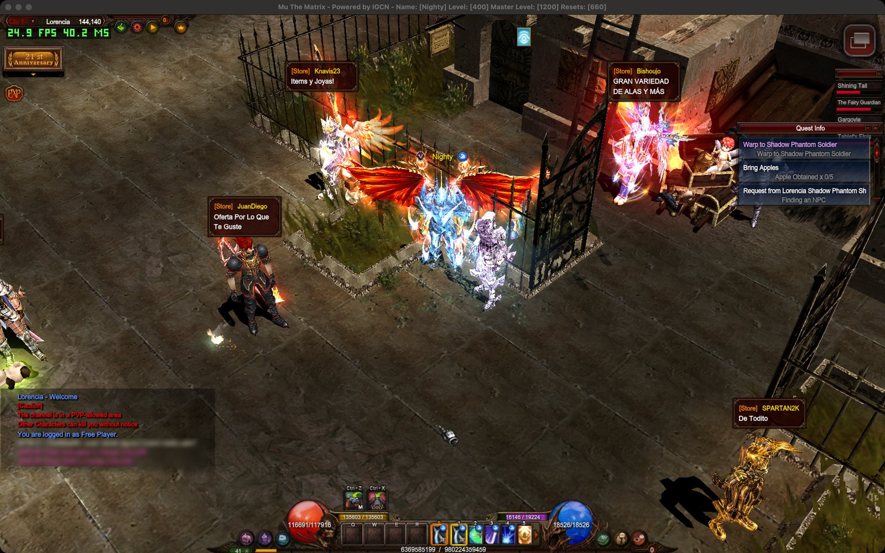
</p>

<p align="center">
  <a href="#install">Install</a> ·
  <a href="#settings">Settings</a> ·
  <a href="#how-it-reaches-25-fps">Performance</a> ·
  <a href="#how-it-works">How it works</a> ·
  <a href="#building-the-app">Building</a> ·
  <a href="#troubleshooting">Troubleshooting</a> ·
  <a href="https://github.com/fryezero/mu-the-matrix-native">Native port</a>
</p>

---

## What this is

**Mu The Matrix.app** is a free Mac app that installs and runs the official Windows version of
[Mu The Matrix](https://muthematrix.com) on Macs with an Apple chip. It sets up everything the game needs (a free
Wine runtime, Microsoft .NET Framework 4.8 and the game itself) from a single window, then opens the server's
official launcher. You log in with your normal account and play on the normal servers.

- **Free.** It uses CodeWeavers' open-source Wine (the code inside CrossOver), so you do not need a CrossOver licence.
- **Fast.** The game caps itself at 25 FPS. With the performance work in this repository it holds that cap in
  towns, hunting spots and crowded boss fights on the Macs we tested.
- **Unchanged game.** The game files come from the official installer (or your own copy). The app never sees or
  stores your password.

This repository holds the app, its installer, the performance components and all the research behind them. Its
sister project, [**mu-the-matrix-native**](https://github.com/fryezero/mu-the-matrix-native), is rebuilding the
client as a real native macOS program, without Wine. Until that is finished, this app is how you play on a Mac.

| | |
|---|---|
| 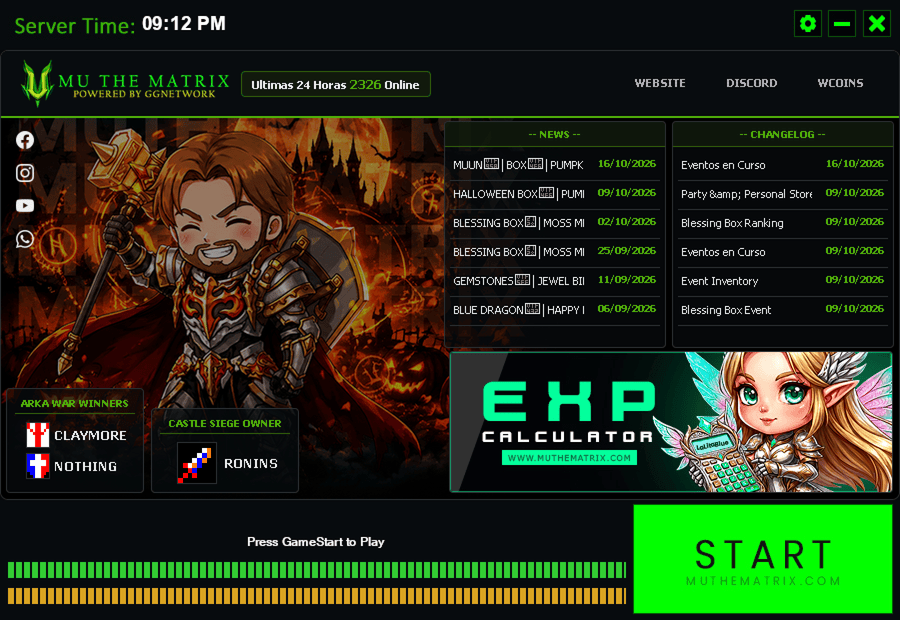 | 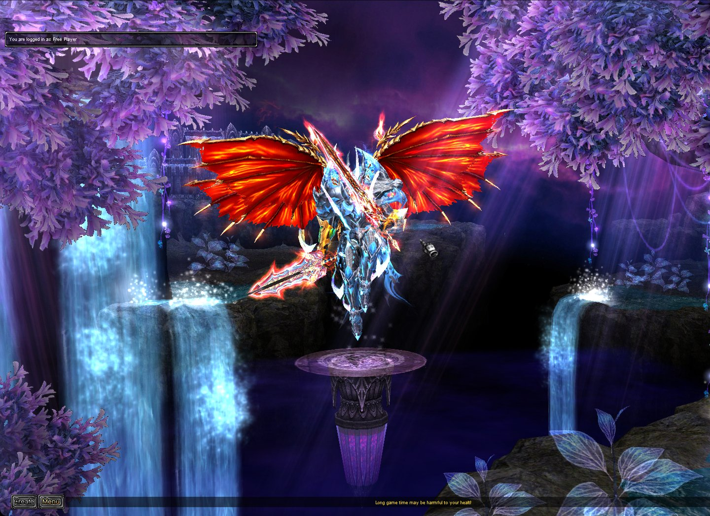 |
| The server's official launcher, with its own skin | Character select |
| 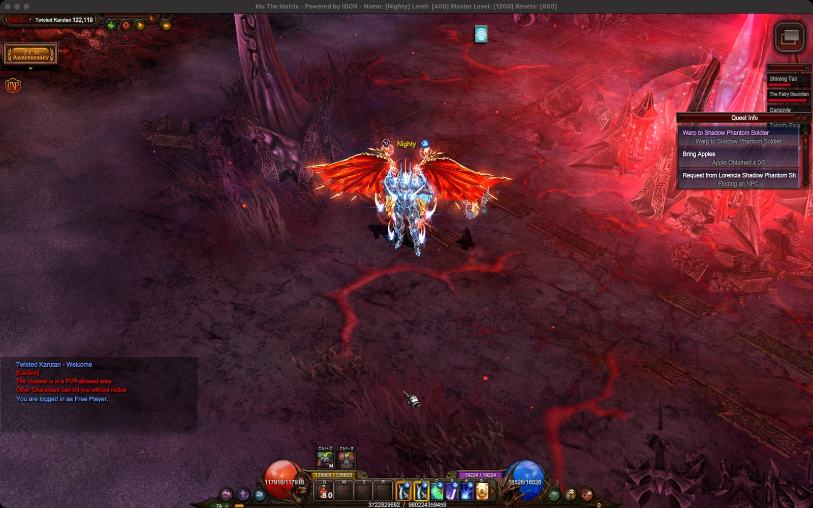 | 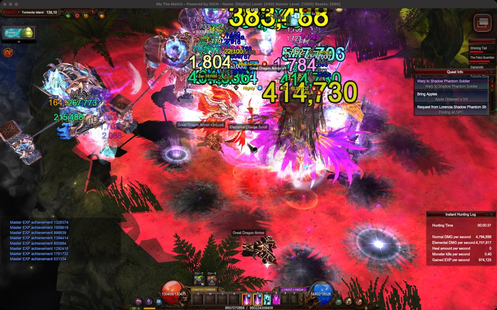 |
| Twisted Karutan | A busy hunting spot on Tormenta Island, with the free runtime |

## Requirements

| What | Needed |
|---|---|
| Mac | An **Apple chip** (M1 or newer). Intel Macs are not supported. |
| macOS | **13 Ventura or newer**. Testing so far: macOS 27 on an M5 Mac. |
| Disk space | About **12 GB** free during installation (the game then uses about 5 GB). |
| Internet | About 2.4 GB is downloaded: the game (2.2 GB) from the official server and .NET Framework 4.8 from Microsoft. |
| Rosetta 2 | Apple's free translator for Intel programs. If it is missing, the app offers to install it. |
| Account | Your Mu The Matrix account (the same one you use on Windows). |

## Install

The full, illustrated walkthrough for players is the **[player guide](mac-play/PLAYER-GUIDE.md)**. In short:

### 1. Open the disk image

Download **Mu The Matrix.dmg** (about 130 MB) from the official Mu The Matrix website and open it. Drag
**Mu The Matrix** onto **Applications**.

<p align="center">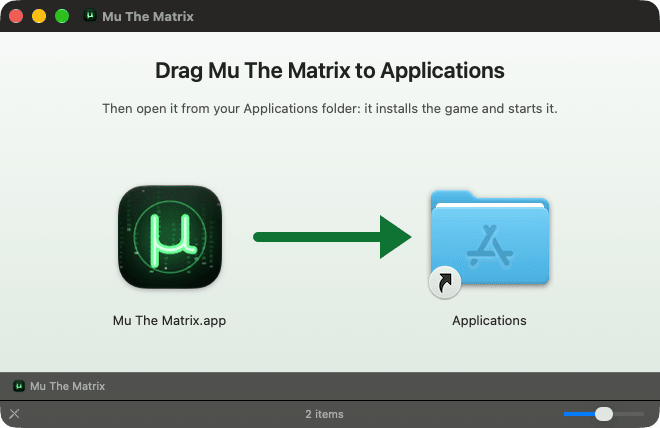</p>

### 2. Allow the app to open (first time only)

The app is not notarized by Apple yet, so the first time macOS shows **"Mu The Matrix.app" Not Opened**. Click
**Done**, then open **System Settings > Privacy & Security**, scroll to **Security** and click **Open Anyway** next
to "Mu The Matrix.app". Confirm with Touch ID or your password. From then on it opens normally.

<p align="center">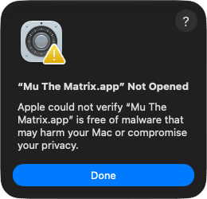</p>

> [!TIP]
> If you open the app straight from the disk image or from Downloads, it offers to **Move to Applications**: it
> copies itself there, reopens and ejects the disk image.
>
> 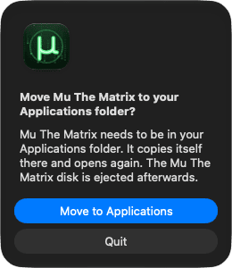

### 3. Install

Click **Install**. One window shows what is happening and a single progress bar. The first installation takes
about 45 minutes in our test, mostly the 2.2 GB game download; you can keep using your Mac. If you already have
the game files (for example from a Windows PC), click **Use a game folder I already have…** instead: that takes
5 to 10 minutes.

| Welcome | Installing |
|---|---|
| 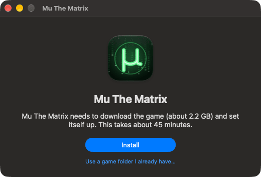 | 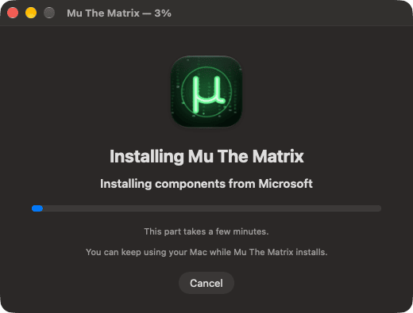 |

If the connection drops, **Try Again** continues where it stopped. **Cancel** stops cleanly and keeps what is done.

### 4. Play

When it has finished, the official launcher opens by itself. Click the green **START** button, choose a server and
log in. Next time, just open **Mu The Matrix** from Applications or the Dock.

## Settings

Hold **Option (⌥)** while opening the app, or choose **Mu The Matrix > Settings…**, to see its window:

<p align="center">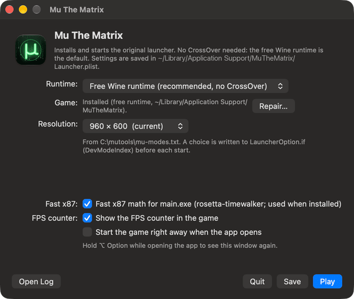</p>

| Setting | What it does |
|---|---|
| **Runtime** | What runs the Windows game. Leave it on **Free Wine runtime**; a CrossOver bottle is still supported. |
| **Game** | **Install…** or **Repair…** (fixes missing parts and installs updates without downloading the game again). |
| **Resolution** | The game window size, applied before each start; or **Keep launcher setting**. |
| **Fast x87** | The speed-up for the game's 3D maths (see below). Leave it on. |
| **FPS counter** | Shows frames per second and frame time in the top-left corner of the game (green from 24 FPS, yellow from 15, red below). It can be switched while playing. |
| **Start the game right away** | Skip this window and open the launcher directly. |
| **Open Log** | Shows the logs in `~/Library/Logs/MuTheMatrix` for your server team. |

## How it reaches 25 FPS

Mu The Matrix runs its game logic in fixed 40 ms steps and caps drawing at **25 frames per second**. On the
first Mac setup in October 2026 the game ran at **about 4 FPS** in Twisted Karutan. Four pieces of work, each
measured in the live game, brought it to the cap:

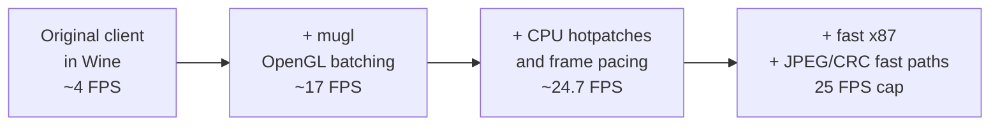

1. **A free Wine runtime that is as fast as CrossOver.** Upstream WineHQ builds cannot start the protected client.
   CodeWeavers' open-source Wine can run it in a 32-bit prefix in wow64 mode, so we build CrossOver 26.3's Wine
   from CodeWeavers' published sources ([`build-wine.sh`](mac-play/installer/packaging/build-wine.sh)) and the app
   bundles it. In the same busy scene it runs at the same speed as CrossOver itself (18.1 vs 18.3 FPS before
   fast x87), and 25% faster than the older public build.
2. **mugl, an OpenGL batching proxy.** The client draws with old-style immediate-mode OpenGL: about a million tiny
   calls per second, each crossing from 32-bit Windows code into macOS. [`mugl`](mac-play/mugl/README.md) is a
   replacement `opengl32.dll` that collects those calls into vertex arrays and submits them in batches (in one
   measured interval, 999,569 blocks became 8,966 draws). Its [hotpatch build](mac-play/hotpatch/README.md) adds
   native versions of the client's hottest routines (vertex transforms and skinning, the mesh draw loop,
   character shadows, terrain decals), quad batching, off-screen culling, terrain sorting, precise frame pacing
   with waitable timers and a higher render-thread priority. Map loading uses native JPEG decoding
   (libjpeg-turbo) and a native CRC-32, each checked bit for bit against the client's own results. It also draws
   the optional FPS counter.
3. **Fast x87.** The client does its 3D maths with the old x87 floating-point instructions, which Rosetta 2
   translates very slowly (2.6 million vertex transforms per second in our benchmark). The app runs the game
   through [rosetta-timewalker](https://github.com/aprilmaccydee/rosetta-timewalker)'s x87 translator: 290 to 305
   million per second, with identical results. A small [wrapper](mac-play/x87-main-only-wrapper.c) applies it to
   `main.exe` only, because the .NET launcher hangs with it.
4. **Launcher fixes (mscoree proxy).** A small proxy DLL loaded by the launcher provides the display-mode list
   (resolution choice), keeps the launcher's news panel from floating over the game, turns the launcher's
   minimize-to-tray into a normal Dock minimize, and works around a Wine JPEG decoder bug that used to crash the
   server's official launcher skin.

Selected measurements (one M5 Mac, macOS 27, live servers; same-session comparisons where marked):

| Scene | Before | After | What changed |
|---|---:|---:|---|
| Twisted Karutan, in world | ~4 FPS | 25 FPS | Batching, then VBO emulation and CPU hotpatches (different sessions) |
| Twisted Karutan hunting spot, MU Helper on | 20.5 FPS, 48.5 ms work | 24.7 FPS, 37–39 ms | CPU hotpatches v7.0 (mask 0 vs 15) |
| Twisted Karutan spawn, heavy background load | 11.8 FPS, 85.8 ms | 22.1 FPS, 44.9 ms | Terrain sorting and thread priority (v7.3, same session) |
| Twisted Karutan zoomed out (F6), light load | 24.4–24.8 FPS, 40–41 ms | 24.99–25.00 FPS, 36–37 ms | Quad batching, deferred state, culling (v7.4, same session) |
| Tormenta Island boss fight, many players | 21.1–22.8 FPS, 44–48 ms | 24.99–25.01 FPS, 33–35 ms | Native shadows, decals, mesh append (v7.5, same session) |
| Same boss area, free runtime | 14.5 FPS (older public Wine) / 18.1 FPS (CX26 Wine) | 25.0 FPS, 33.6 ms | Fast x87 with the free CX26 runtime |
| Lorencia, standing | | 25.00 FPS, 12 ms work | |

"Work" is the time the game needs per frame before it sleeps to its 40 ms step; below 40 ms means the cap is
reached. The zoomed-out boss fight is the one case that still runs below the cap (about 20 to 23 FPS). Full
measurements, methods and limits: [performance report](docs/research/mac-performance.md) and
[free runtime report](docs/research/mac-free-runtime.md).

## How it works

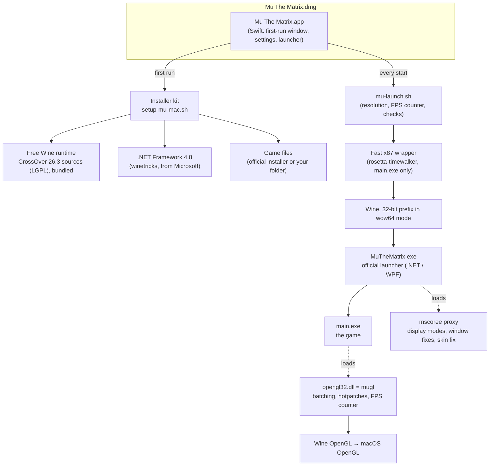

The app lives in `~/Applications` or `/Applications`; everything it installs goes to
`~/Library/Application Support/MuTheMatrix` (the Wine prefix with the game in `C:\MuTheMatrix`), and logs go to
`~/Library/Logs/MuTheMatrix`. Uninstalling is deleting those folders and the app
([details](mac-play/PLAYER-GUIDE.md#uninstalling)).

## Building the app

You need macOS 13+ with the Xcode Command Line Tools. Python 3 (standard library) runs the tests;
`brew install mingw-w64` adds the Windows cross-builds.

```sh
git clone https://github.com/fryezero/mu-the-matrix-mac.git
cd mu-the-matrix-mac
make test                          # installer and app test suites, no game files needed
make mac-bundle                    # development app: mac-play/bundle/build/Mu The Matrix.app
bash scripts/local-macos-ci.sh     # everything, the gate before merging
```

A **player build** bundles four inputs that are not in this repository, because they are built from private or
third-party material:

| Input | What it is | Where it comes from |
|---|---|---|
| `EMBED_MUGL` | `mugl-v77.dll`, the hotpatch build of the OpenGL proxy | `make -C mac-play/hotpatch private` from the owner's own client dump (its tables contain client-derived bytes, so it is never published) |
| `EMBED_MSCOREE` | The mscoree proxy v3 | `make mac-hotpatch` (`build/modes/mscoree.dll`) |
| `EMBED_FAST_X87` | rosetta-timewalker's x87 runtime files | [`package-fast-x87.sh`](mac-play/installer/packaging/package-fast-x87.sh) |
| `EMBED_RUNTIME` | `winecx-26.3.0-mu1.tar.xz`, the Wine runtime (132 MB, SHA-256 pinned) | [`build-wine.sh`](mac-play/installer/packaging/build-wine.sh) from CodeWeavers' sources |

```sh
make player-dmg EMBED_MUGL=… EMBED_MSCOREE=… EMBED_FAST_X87=… EMBED_RUNTIME=… DMG="…/Mu The Matrix.dmg"
# optional: SIGN_IDENTITY="Developer ID Application: …" NOTARY_PROFILE=… to sign and notarize
```

`player-app` refuses to build if an input is missing or is not the pinned build. Details:
[app README](mac-play/bundle/README.md), [installer README](mac-play/installer/README.md),
[disk image report](docs/research/mac-dmg-installer.md).

## Repository layout

```text
mac-play/
  PLAYER-GUIDE.md        Player instructions (install, settings, troubleshooting)
  bundle/                Mu The Matrix.app (Swift), mu-launch.sh, disk image builder, app tests
  installer/             Installer kit: setup-mu-mac.sh, verify, Wine runtime packaging, tests
  mugl/                  Public OpenGL immediate-mode batching proxy and FPS counter
  hotpatch/              mugl hotpatch build: native client routines, pacing, JPEG/CRC, table generator
  mumodes/               mscoree proxy: display modes, launcher window fixes, WIC/JPEG skin fix
  machprof/              Mach-level profilers for the running client (stack, stall, memory)
  diagnostics/           GL and x87 benchmarks, EIP profiler, bottle checks
  automation/            Live-test helpers: login automation, input, window screenshots
  fast-x87.sh, install-fast-x87.sh, x87-main-only-wrapper.c   Fast x87 integration
  setup-crossover-32bit.sh, cxwine, start-launcher.sh         Legacy CrossOver bottle route
docs/
  status.md, roadmap.md, handoff.md   Where things stand and what is next
  research/mac-*.md      Investigations: CrossOver, free runtime, performance, launcher, disk image
  images/                README screenshots
tests/                   Python tests (publication boundary, mugl, hotpatch tables, installer, app)
scripts/                 local-macos-ci.sh (merge gate), audit_repository.py (publication audit)
```

## Troubleshooting

| Problem | What to do |
|---|---|
| "Mu The Matrix.app" Not Opened / is damaged | [Allow the app](mac-play/PLAYER-GUIDE.md#3-allow-the-app-to-open-first-time-only) in Privacy & Security (or the Terminal line in the guide). |
| Rosetta 2 is needed | Click **Install Rosetta**, or run `sudo softwareupdate --install-rosetta --agree-to-license`. |
| A download did not finish | Check the connection and click **Try Again**; it resumes. |
| The launcher does not appear | The first start can take a minute. If the app says it is already running, close the launcher/game in the Dock. |
| Problems after an app update | Hold Option while opening the app, click **Repair…**. |
| The game is slow | Leave **Fast x87** on; choose a smaller **Resolution**. 25 FPS is the game's own maximum. |

More cases and how to send logs: [player guide, Troubleshooting](mac-play/PLAYER-GUIDE.md#troubleshooting).

## Project status

Working: install from the disk image, the official launcher with its skin, login and gameplay on live servers at
the 25 FPS cap in tested scenes, settings, repair and updates. Open: Apple notarization (removes the "Open Anyway"
step), a full rehearsal from the final disk image on a clean account, tests on more Macs and older macOS
versions, the zoomed-out boss fight below 25 FPS, and a rare launcher "Hash Protection" dialog. See
[status](docs/status.md) and [roadmap](docs/roadmap.md).

Contributions and reports from other Macs are welcome: see [CONTRIBUTING.md](CONTRIBUTING.md) and
[AGENTS.md](AGENTS.md). There is no hosted CI; `scripts/local-macos-ci.sh` on a Mac is the gate.

## Credits and licenses

The code in this repository is MIT licensed ([LICENSE](LICENSE)). It installs or bundles, but does not contain:

| Component | License |
|---|---|
| [Wine](https://www.winehq.org) from [CodeWeavers' CrossOver 26.3 sources](https://www.codeweavers.com/crossover/source) | GNU LGPL 2.1+ (sources listed in [`wine-runtime-SOURCES.txt`](mac-play/bundle/licenses/wine-runtime-SOURCES.txt)) |
| wine-gecko, and x86_64 libraries from [Sikarugir](https://github.com/Sikarugir-App) (freetype, gnutls, …) | MPL 2.0 and their own licenses |
| [rosetta-timewalker](https://github.com/aprilmaccydee/rosetta-timewalker) and [rosettax87_jit](https://github.com/Lifeisawful/rosettax87_jit) | MIT (with BSD notices for embedded math routines) |
| [libjpeg-turbo](https://libjpeg-turbo.org) (optional, hotpatch JPEG path) | IJG, BSD-3-Clause, zlib |
| Microsoft .NET Framework 4.8 (downloaded by winetricks from Microsoft) | Microsoft's terms |

Full notices: [THIRD_PARTY_NOTICES.md](THIRD_PARTY_NOTICES.md). Mu The Matrix, its client, launcher, artwork and
servers belong to their owners and are not covered by this repository's license; the screenshots show the game
for illustration. No game files, client-derived DLLs or runtime archives are stored here.

This project grew out of the Mu The Matrix recovery work; its history before October 2026 (issues #39 to #136)
is in [mu-the-matrix-native](https://github.com/fryezero/mu-the-matrix-native).
